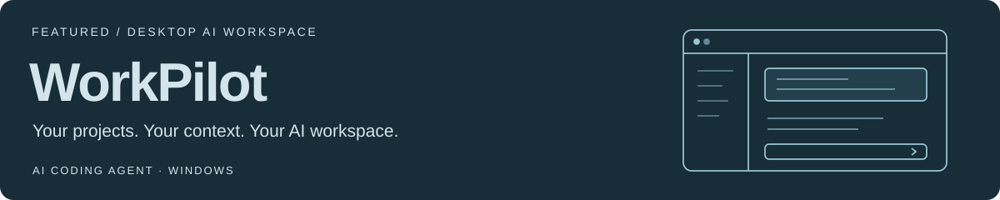

<!-- Profile source: https://github.com/Bindy-lbb/Bindy-lbb -->
<picture>
  <source media="(prefers-color-scheme: dark)" srcset="./assets/header-dark.svg">
  <source media="(prefers-color-scheme: light)" srcset="./assets/header-light.svg">
  
</picture>

  <a href="#about">About</a> ·
  <a href="#opensource">Open Source</a> ·
  <a href="#engineering">What I Build</a> ·
  <a href="#projects">Selected Work</a> ·
  <a href="#skills">Agent Skills</a> ·
  <a href="#toolbox">Toolbox</a>

## Hi, I'm Bindy

**Frontend & AI Application Developer** building web applications, interactive 3D experiences, and AI workflows—turning ideas into useful tools that people can try, use, and improve.

- **Web applications:** I build workspaces, dashboards, and interactive interfaces with React / Vue and TypeScript, connecting them to APIs and services with Node.js / Python.
- **Interactive 3D & visualization:** I use Three.js / React Three Fiber, SVG, and Leaflet to explore virtual exhibitions, synchronized 2D and 3D views, wiring simulations, and interactive maps. Projects include [PALEO](https://github.com/Bindy-lbb/dinosaur) and [WiringLab](https://github.com/Bindy-lbb/wiringlab).
- **AI applications & tools:** My work includes RAG / GraphRAG, knowledge-based Q&A, and content workflows. I contribute to [WorkPilot](https://github.com/amaxsmp/WorkPilot), develop the [WritePilot browser extension](https://github.com/Bindy-lbb/ai-write-auto), and collect reusable workflows in [Bindy-skills](https://github.com/Bindy-lbb/Bindy-skills).
- **Open source & delivery:** I contribute features and fixes to ByteFolk's desktop workspace, design system, and example projects, including release delivery, demo deployment, and documentation.

## Open Source Contributions

I contribute workspace features, design system components, and reusable examples to ByteFolk projects. Selected merged contributions:

| Project | Contributions | Related PRs |
| :--- | :--- | :--- |
| [RoleWeave](https://github.com/bytefolk/roleweave) | Goal and project workspaces, settings interfaces, interaction fixes, and desktop releases | [#569](https://github.com/bytefolk/roleweave/pull/569) · [#581](https://github.com/bytefolk/roleweave/pull/581) · [#583](https://github.com/bytefolk/roleweave/pull/583) |
| [Workbench Examples](https://github.com/bytefolk/workbench-examples) | MUSE digital human example, model gateway integration, and separation of the public demo from live services | [#1](https://github.com/bytefolk/workbench-examples/pull/1) |
| [Design System](https://github.com/bytefolk/design-system) | Consistent APIs for selector components | [#32](https://github.com/bytefolk/design-system/pull/32) |
| [Digital Employee Quickstart](https://github.com/bytefolk/digital-employee-quickstart) | Engineering team examples, design review guidance, and role-specific skill examples | [#38](https://github.com/bytefolk/digital-employee-quickstart/pull/38) · [#45](https://github.com/bytefolk/digital-employee-quickstart/pull/45) · [#46](https://github.com/bytefolk/digital-employee-quickstart/pull/46) |

[View my public pull requests →](https://github.com/pulls?q=is%3Apr+author%3ABindy-lbb+is%3Apublic)

## What I Build

I work across interfaces, interactions, service integration, and delivery, with attention to the complete user experience. These are the main areas represented in my projects:

| Area | Practical Focus | Projects |
| :--- | :--- | :--- |
| Web applications & frontend interaction | React / Vue, TypeScript, workspace interfaces, components, and business workflows | MUSE workspace, ByteFolk contributions |
| Three.js & interactive 3D | Model inspection, size comparison, synchronized 2D / 3D views, wiring validation, and simulation | [PALEO](https://github.com/Bindy-lbb/dinosaur), [WiringLab](https://github.com/Bindy-lbb/wiringlab) |
| AI & knowledge applications | RAG / GraphRAG, document parsing, retrieval and reranking, model APIs, and content workflow integration | Q&A and content tools, MUSE workspace |
| Desktop applications & browser extensions | Desktop workspaces, browser content extraction, writing assistance, and releases | [WorkPilot](https://github.com/amaxsmp/WorkPilot), [WritePilot](https://github.com/Bindy-lbb/ai-write-auto) |
| Data tools & reusable workflows | Python data scripts, interactive maps, and reusable Agent Skills | [asock](https://github.com/Bindy-lbb/asock), [Leaflet Map Experiments](https://github.com/Bindy-lbb/leaflet-demo-master), [Bindy-skills](https://github.com/Bindy-lbb/Bindy-skills) |

## Selected Work

### WorkPilot · Desktop AI Coding Workspace

A desktop workspace for AI-assisted coding, organized around projects, conversations, file context, and model configuration. It includes project management, skill invocation hints, and in-app updates.

`Desktop App` `AI Coding Agent` `Windows`

**[Download the latest release ↗](https://github.com/amaxsmp/WorkPilot/releases/latest)** · [Project overview & usage](https://github.com/amaxsmp/WorkPilot)

The public repository provides Windows installers and release notes.

<table>
<tr>
<td width="50%" valign="top">

<h3>PALEO · Prehistoric Archives</h3>

Explore the prehistoric world in your browser: 14 collection entries, interactive 3D models, species information, size comparisons, and a timeline map.

<code>React</code> <code>TypeScript</code> <code>Three.js</code>

<a href="https://bindy-lbb.github.io/dinosaur/"><b>Explore online ↗</b></a> · <a href="https://github.com/Bindy-lbb/dinosaur">Source code</a>

</td>
<td width="50%" valign="top">

<h3>WiringLab · Electrical Wiring Practice</h3>

Practice electrical wiring with synchronized 2D and 3D views, connection validation, power-on simulation, and locally saved progress.

<code>React</code> <code>TypeScript</code> <code>React Three Fiber</code>

<a href="https://bindy-lbb.github.io/wiringlab/"><b>Try it online ↗</b></a> · <a href="https://github.com/Bindy-lbb/wiringlab">Source code</a>

</td>
</tr>
<tr>
<td width="50%" valign="top">

<h3>MUSE · Digital Human Content Workspace</h3>

A workspace concept for AI content production, bringing together brand materials, character assets, video creation, task review, and archiving.

<code>React</code> <code>TypeScript</code> <code>AI Workflow</code>

<a href="https://bindy-lbb.github.io/brand-digital-human-demo-pages/"><b>Simulated demo ↗</b></a> · <a href="https://github.com/bytefolk/workbench-examples/tree/main/examples/saas/dam/brand-digital-human-studio">Example source</a>

</td>
<td width="50%" valign="top">

<h3>WritePilot · AI Writing Assistant</h3>

A browser extension workflow connecting trending topic discovery, content extraction, AI rewriting, and filling out publishing pages.

<code>TypeScript</code> <code>Plasmo</code> <code>NestJS</code>

<a href="https://github.com/Bindy-lbb/ai-write-auto"><b>Source code ↗</b></a> · <a href="https://github.com/Bindy-lbb/ai-write-auto#readme">Setup guide</a>

</td>
</tr>
</table>

The MUSE public demo uses synthetic examples and fixed video clips to illustrate its workflow; live model calls are not enabled on the public site. WiringLab is a software learning tool and does not replace hands-on electrical safety training.

<b>More Tools & Experiments</b>

| Project | Purpose | Stack |
| :--- | :--- | :--- |
| [FitBuddy · Shared Check-ins](https://github.com/Bindy-lbb/fit-buddy) | Lightweight exercise check-ins and mutual accountability for small groups; shared use requires backend configuration | TypeScript · Supabase |
| [asock · Sector Analysis](https://github.com/Bindy-lbb/asock) | Data scripts and an AI Skill for researching A-share market sectors; personal research only, not investment advice | Python · AI Skill |
| [Leaflet Map Experiments](https://github.com/Bindy-lbb/leaflet-demo-master) | Map markers, annotations, clustering, and map layer integration | Vue · Leaflet |

## Reusable Agent Skills

[**Bindy-skills →**](https://github.com/Bindy-lbb/Bindy-skills)

Reusable Agent Skills drawn from practical workflows, with instructions, reference rules, scripts, and output templates. More skills will be added over time.

| Skill | Capabilities | Output |
| :--- | :--- | :--- |
| [Job Search Matching · job-search-match](https://github.com/Bindy-lbb/Bindy-skills/tree/main/job-search-match) | Find roles based on a resume or search criteria, verify sources, examine company background and fit, score consistently, and update previous results | A standalone HTML report with filters, side-by-side comparisons, original job links, and items to confirm |

`Agent Skills` `AI Workflow` `Python` `HTML`

Each skill lives in its own directory and can be used independently. The repository contains reusable workflows and templates, not personal resumes, job records, or application histories. The job search skill provides links for users to apply themselves by default.

## Toolbox

  
  
  
  
  
  
  

**Web & Frontend** — React / Vue, TypeScript, Vite, components, and business interfaces. 
**3D & Visualization** — Three.js / React Three Fiber, SVG, Leaflet, model presentation, scene interaction, and synchronized 2D / 3D views. 
**Services & Integration** — Node.js / NestJS, Python / FastAPI, and model APIs. 
**Tools & Automation** — Desktop workspaces, browser extensions, visual workflows, and Agent Skills. 
**Knowledge & Retrieval** — RAG / GraphRAG, embeddings, rerankers, document parsing, and knowledge graph visualization. 
**Data & Delivery** — MongoDB, Neo4j, OceanBase, Prisma / SQLite, Supabase, Docker Compose, Nginx, and GitHub Actions.

---

<b>Start with a small idea. Build something useful.</b> Try the projects, share feedback, or open an issue in the relevant repository.

