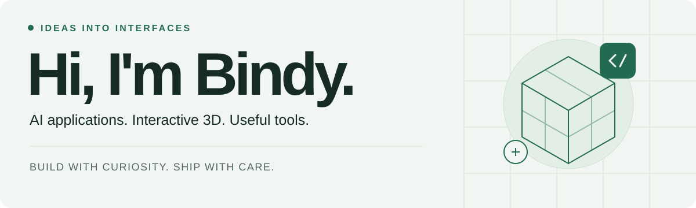
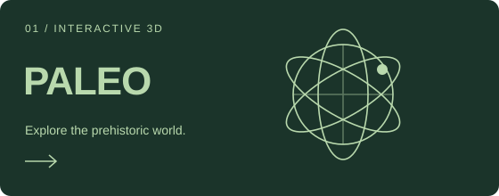
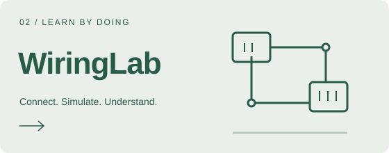
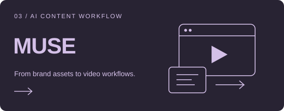
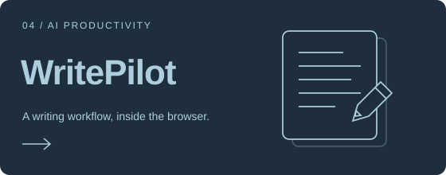

<!-- Profile source: https://github.com/Bindy-lbb/Bindy-lbb -->
<picture>
  <source media="(prefers-color-scheme: dark)" srcset="./assets/header-dark.svg">
  <source media="(prefers-color-scheme: light)" srcset="./assets/header-light.svg">
  
</picture>

  <a href="#about">关于我</a> ·
  <a href="#opensource">开源贡献</a> ·
  <a href="#engineering">AI 工程实践</a> ·
  <a href="#projects">精选作品</a> ·
  <a href="#toolbox">技术工具箱</a>

## 你好，我是 Bindy

一名喜欢把想法做成可体验作品的开发者。做过 **RAG 知识库、AI 工作流与业务应用的集成开发**，也在探索交互式 3D、数字人和内容创作工具。

从文档接入、知识检索和模型调用，到前端工作台与多服务部署，我喜欢把分散的能力串成可以实际使用的流程。

- **做过的方向**：知识库问答、图谱增强检索、可视化工作流、文档解析与模型服务接入。
- **最近在做**：AI 内容创作与数字人工作台、浏览器里的 3D 交互和实用工具。
- **参与开源**：在 ByteFolk 的桌面工作区、设计系统与案例库中提交功能和修复。

## 开源中的足迹 / Open source

持续参与 ByteFolk 的开源协作，贡献工作区功能、设计系统组件与可复用案例。以下是部分已合并的工作：

| 项目 | 我的贡献 | 相关 PR |
| :--- | :--- | :--- |
| [RoleWeave](https://github.com/bytefolk/roleweave) | 目标与项目工作区、设置界面、交互修复与桌面版本交付 | [#569](https://github.com/bytefolk/roleweave/pull/569) · [#581](https://github.com/bytefolk/roleweave/pull/581) · [#583](https://github.com/bytefolk/roleweave/pull/583) |
| [Workbench Examples](https://github.com/bytefolk/workbench-examples) | MUSE 数字人案例、模型网关接入与公开演示隔离 | [#1](https://github.com/bytefolk/workbench-examples/pull/1) |
| [Design System](https://github.com/bytefolk/design-system) | 统一选择器组件接口 | [#32](https://github.com/bytefolk/design-system/pull/32) |
| [Digital Employee Quickstart](https://github.com/bytefolk/digital-employee-quickstart) | 研发团队案例、设计评审指南与角色技能示例 | [#38](https://github.com/bytefolk/digital-employee-quickstart/pull/38) · [#45](https://github.com/bytefolk/digital-employee-quickstart/pull/45) · [#46](https://github.com/bytefolk/digital-employee-quickstart/pull/46) |

[查看我的公开 PR →](https://github.com/pulls?q=is%3Apr+author%3ABindy-lbb+is%3Apublic)

## 做过的 AI 工程 / AI engineering

除了下面可以直接体验的作品，我也做过知识库与 AI 工作流平台的集成开发，涉及从资料处理到检索问答、流程编排和部署的多个环节。

| 方向 | 项目实践 |
| :--- | :--- |
| **RAG 知识库与问答** | 围绕文档导入、切片、向量索引与语义召回构建知识检索链路，结合重排、引用回查与模型回答，让结果可以追溯到原始资料。 |
| **图谱增强检索** | 结合实体与关系抽取、图数据库和向量检索，探索从具体实体与主题关系两条路径召回证据；配套图谱浏览和知识检索界面。 |
| **可视化 AI 工作流** | 围绕节点式编排，进行模型调用、知识检索、条件分支、HTTP 请求与工具调用的配置和集成，将多步处理组织成可复用流程。 |
| **PDF 解析与资料处理** | 接入独立文档解析服务，编排上传、异步任务、状态轮询和结果获取，整理 Markdown 与图片资源，为后续知识入库提供内容。 |
| **多服务集成与部署** | 对接 Web/API、检索、工具与模型服务，处理反向代理、环境配置、容器编排和数据持久化，让不同能力在同一业务流程中协作。 |

**我关注的链路**：资料接入 → 内容解析与索引 → 检索与重排 → 引用溯源 → 模型回答与工作流应用。

## 精选作品 / Selected work

<table>
<tr>
<td width="50%" valign="top">

<h3>PALEO · 史前档案</h3>

把史前世界搬进浏览器：14 个馆藏条目、3D 模型观察、知识探索、体型比较与年代地图。

<code>React</code> <code>TypeScript</code> <code>Three.js</code>

<a href="https://bindy-lbb.github.io/dinosaur/"><b>在线探索 ↗</b></a> · <a href="https://github.com/Bindy-lbb/dinosaur">查看源码</a>

</td>
<td width="50%" valign="top">

<h3>接线工坊 · WiringLab</h3>

在二维与三维之间同步练习电工接线，支持接线检查、通电模拟和本地进度保存。

<code>React</code> <code>TypeScript</code> <code>React Three Fiber</code>

<a href="https://bindy-lbb.github.io/wiringlab/"><b>在线练习 ↗</b></a> · <a href="https://github.com/Bindy-lbb/wiringlab">查看源码</a>

</td>
</tr>
<tr>
<td width="50%" valign="top">

<h3>MUSE · 品牌数字人工作台</h3>

围绕品牌素材、人物资产、视频创作、任务审核与归档，探索 AI 内容生产的工作台体验。

<code>React</code> <code>TypeScript</code> <code>AI Workflow</code>

<a href="https://bindy-lbb.github.io/brand-digital-human-demo-pages/"><b>模拟演示 ↗</b></a> · <a href="https://github.com/bytefolk/workbench-examples/tree/main/examples/saas/dam/brand-digital-human-studio">案例源码</a>

</td>
<td width="50%" valign="top">

<h3>WritePilot · AI 写作助手</h3>

把热点发现、内容提取、AI 改写与发布页填充串起来，探索浏览器扩展中的内容创作流程。

<code>TypeScript</code> <code>Plasmo</code> <code>NestJS</code>

<a href="https://github.com/Bindy-lbb/ai-write-auto"><b>查看源码 ↗</b></a> · <a href="https://github.com/Bindy-lbb/ai-write-auto#readme">运行说明</a>

</td>
</tr>
</table>

MUSE 在线版本使用合成示例与固定样片，展示模拟流程；真实模型调用未在公开站点开放。接线工坊用于软件练习，不替代实际电气作业培训。

<b>更多小工具与实验</b>

| 项目 | 想解决的问题 | 技术 |
| :--- | :--- | :--- |
| [FitBuddy · 打卡墙](https://github.com/Bindy-lbb/fit-buddy) | 为熟人小组设计轻量运动打卡与互相监督流程；多人共享需配置后端 | TypeScript · Supabase |
| [asock · 板块分析工具](https://github.com/Bindy-lbb/asock) | 用数据脚本与 AI Skill 辅助整理 A 股板块信息，供个人研究，非投资建议 | Python · AI Skill |
| [Leaflet 地图实验](https://github.com/Bindy-lbb/leaflet-demo-master) | 地图打点、标记、聚合与图层接入 | Vue · Leaflet |

## 技术工具箱 / Toolbox

  
  
  
  
  
  
  

**前端与交互** — React / Vue、TypeScript、Vite、Three.js / React Three Fiber、SVG、Leaflet。 
**应用与工作流** — Node.js / NestJS、Python / FastAPI、可视化工作流、浏览器扩展、模型 API 接入。 
**知识与检索** — RAG / GraphRAG、Embedding、Reranker、文档解析、知识图谱可视化。 
**数据与交付** — MongoDB、Neo4j、OceanBase、Prisma / SQLite、Supabase、Docker Compose、Nginx、GitHub Actions。

---

<b>从一个小想法开始，把它做成能用的东西。</b> 欢迎试用、交流，也欢迎在对应项目中提交 Issue。

